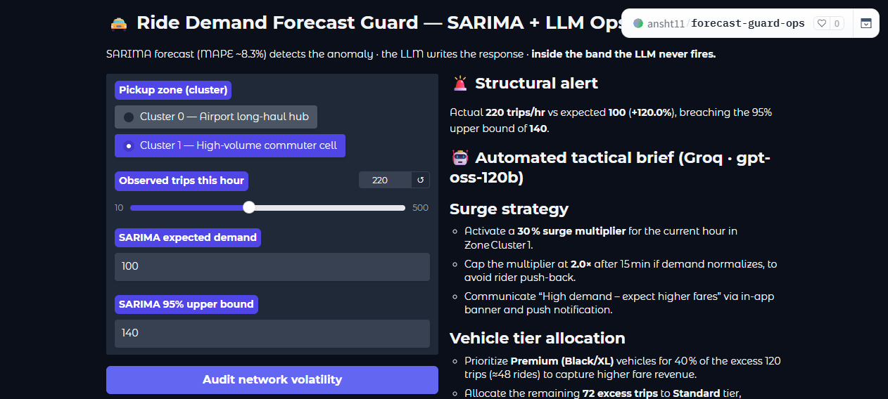

# Ride Demand and Revenue Forecasting

> **⚠️ Data Note:** This project uses a synthetic dataset (35,000 trips, uniform monthly volume, 5 pickup zones) generated for portfolio demonstration. The workflow, modelling techniques, and GenAI integration are the deliverables — not real Uber metrics. See the modelling section for results that would transfer to production data.


*Demand is not spread evenly across the day â€" a single evening spike drives the business. The hourly bars show ~350 trips at 3 AM against 4,053 at 6 PM.*

> 🎉 **Live demo is up:** [**Forecast Guard Ops on Hugging Face Spaces**](https://huggingface.co/spaces/ansht11/forecast-guard-ops)
> — SARIMA breach detector + Groq LLM tactical brief, running free-tier.
> Direct app: https://ansht11-forecast-guard-ops.hf.space



**Business problem:** A ride-hailing operator needs to know *when* to surge-price, *where*
to position premium vehicles, and *which* fleet tier to grow â€" using 35,000 trip records.

---

## â–¶ How to Run
```bash
pip install pandas numpy matplotlib seaborn scikit-learn statsmodels jupyter
# 1. Run the SQL queries in order: 01_data_cleaning.sql → 02_revenue_analysis.sql
# 2. Generate visuals: jupyter notebook Forecast_Clustering_Analysis.ipynb
```
All charts are saved to `image/` and cluster assignments to `outputs/demand_cluster_cells.csv` by the notebook itself. Power BI report: [`powerbi/UberTrip_Dashboard.pbix`](powerbi/UberTrip_Dashboard.pbix). Excel dashboard: [`excel_analysis/uber_trips_data.xlsx`](excel_analysis/uber_trips_data.xlsx).

### Bonus: run the GenAI Forecast Guard portal locally

```bash
pip install -r requirements.txt langchain-openai streamlit requests
set GROQ_API_KEY=<free key — https://console.groq.com>   # optional
streamlit run app_ops.py --server.port 8502
```

> **Honest scoping:** `app_ops.py` is a *manual-input demo* — you supply the SARIMA
> outputs (expected demand + 95% upper bound) and observed demand; the SARIMA model
> itself is trained in `Forecast_Clustering_Analysis.ipynb`, which forecasts
> **daily** demand, while the portal displays operations figures at the **hourly**
> level. Wiring the trained model into the portal live is the next milestone.

---

## 🤖 GenAI Forecast Guard (`forecast_guard.py` + `app_ops.py`)

The SARIMA model already knows when reality is abnormal: any hourly observation
above its one-step 95% upper confidence bound is, statistically, an outlier
(the model holds an 8.3% MAPE, so breaches are not ordinary noise). This layer
turns that silent statistical signal into an automated operational response —
the live screenshot at the top of this README shows exactly this flow.

```
SARIMA forecast (band) ──► observed demand ──► breach?
                                │                         │
                                ├─ inside band ──► ✅ status: normal
                                └─ > 95% upper bound ──► zero-shot LLM chain
                                                        └─ Markdown tactical brief:
                                                           surge strategy · tier
                                                           allocation · fleet deployment
```

- **Decision is math, communication is AI:** the trigger is purely the model's
  confidence interval — the LLM never decides *whether* something is anomalous,
  only *what to do about it* (grounded in the exact breach numbers)
- **Zero-shot, temperature 0:** deterministic output format (Markdown brief:
  ## Surge strategy / ## Vehicle tier allocation / ## Fleet deployment)
- **Free-first:** runs on Groq (llama-3.3-70b) with a free API key; degrades to
  a static advisory document without any key
- `app_ops.py` is the Streamlit operations portal: set observed vs expected
  demand, see the variance metrics and the AI brief the moment the band breaks

## 🧪 LLM Reliability & Eval (`eval_llm.py`)

LLM outputs are tested against a golden set of 5 cases covering anomaly detection logic, graceful degradation (no API key), and output format validation. Run without any API key — the eval covers both the statistical gate and the no-key fallback path.

```bash
python eval_llm.py
# Expected: 5/5 tests passed
```

This separates "I used an LLM" from "I tested my LLM feature."

---

## Business Questions Answered

Every figure below is reproducible from the committed SQL. Click a query link to verify.

| # | Business Question | Metric Used | Finding | Recommended Action | Query |
|:--|:--|:--|:--|:--|:--|
| **Q1** | When should we surge-price and add drivers? | Trips & revenue by hour | **5–7 PM carries 31.2% of all demand** (10,931 of 35,000 trips) in 3 of 24 hours. Peak hour is 6 PM (4,053 trips). | Concentrate incentives on the 5–7 PM window | [§2](sql_queries/02_revenue_analysis.sql) |
| **Q2** | How dependent are we on airport trips? | Revenue split by airport flag | Airport is **39.6% of trips but 54.8% of revenue** (₹74.3L). Avg fare ₹535.77 vs ₹289.40 — **1.85×**. | Protect airport supply; it is the highest-value corridor | [§4](sql_queries/02_revenue_analysis.sql) |
| **Q3** | Which fleet tier earns most per km? | Revenue ÷ distance by vehicle | Uber Black **₹40.06/km vs Uber Pool ₹14.08/km — 2.8×**. But UberX leads total revenue (₹49.1L) on volume. | Grow Black in premium zones; keep UberX as the backbone | [§3](sql_queries/02_revenue_analysis.sql) |
| **Q4** | Do higher-rated drivers earn more? | Avg fare by rating band | **No — and the obvious read is wrong.** Lowest-rated (<4.0) show the *highest* avg fare (₹419 vs ₹364). Cause is trip length (18.9 km vs 16.3 km), not driver quality: fare-per-km is flat at ₹22.06–22.41 across all bands. | Investigate rider experience on long trips — don't penalise drivers | [§11](sql_queries/02_revenue_analysis.sql) |
| **Q5** | Can we focus on just our top zones? | Cumulative revenue share | **No.** It takes **4 of 5 zones to reach 80%** of revenue. Only Airport stands out (27.6%); the rest sit at 17–19% each. | Keep coverage city-wide; a "top zones" strategy fails here | [§10](sql_queries/02_revenue_analysis.sql) |
| **Q6** | Should weekend pricing differ? | Avg fare by weekend flag | **No.** ₹389.34 vs ₹386.05 — a **0.9%** gap, with near-identical trip distance. | Do not build a weekend pricing tier | [§6](sql_queries/02_revenue_analysis.sql) |
| **Q7** | When does the evening rush actually *start*? | Hour-over-hour trip-volume change (`LAG`) | The query measures trip-volume acceleration separately from revenue, so incentive timing is based on demand rather than fare mix. | Use the highest positive trip-volume jump to schedule incentives; validate operationally | [§9](sql_queries/02_revenue_analysis.sql) |
| **Q8** | Is there visible within-year variation? | Trips and revenue by month | Monthly results describe one simulated year only; they do not establish recurring annual seasonality. | Use time-of-day for current operations; validate seasonality with multi-year production data | [§8](sql_queries/02_revenue_analysis.sql) |

**Three of these eight are negative findings.** Q5, Q6 and Q8 tell the business *not* to
act — which prevents wasted spend. Reporting them is part of the job.

---

## Project Overview
This project performs a comprehensive behavioral and financial analysis of a **synthetic ride-sharing transaction dataset** (35,000 trips, generated for portfolio demonstration). Using a two-stage SQL data cleaning pipeline, multi-dimensional MySQL reporting queries, and Excel pivot dashboards, the project uncovers peak demand windows, identifies high-revenue vehicle categories, and produces actionable pricing and allocation recommendations.

### Business Impact Highlights
* **Full Pipeline Coverage:** Built a `ROW_NUMBER()` + `DISTINCT` deduplication safeguard (the source data was already clean, so it removed 0 rows — the value is a reusable, production-style integrity step).
* **Revenue Deep-Dive:** Analyzed fare amounts, distances, and durations across **vehicle types, pickup zones, time periods, and weekend/weekday segments**.
* **Airport Insights:** Quantified airport trip share and its premium fare contribution relative to standard bookings.
* **Operational Recommendations:** Demand heatmap (hourly) used to define surge pricing windows and driver dispatch schedules.

---

## Tech Stack & Technical Architecture
* **MySQL (Window Functions, CTEs, Aggregations):** Two-script SQL pipeline — a dedicated cleaning script followed by a layered business intelligence script covering 11 analytical dimensions, including `LAG()` trend detection and running-total Pareto analysis.
* **Python (Pandas, Matplotlib, Seaborn):** EDA and visual storytelling in `UberTripAnalysis.ipynb`, including heatmaps, bar charts, and distribution plots.
* **Microsoft Excel (Pivot Tables, Charts):** Summary dashboard for stakeholder-ready reporting covering peak hours, vehicle revenue, and location performance.
* **Power BI:** Interactive `.pbix` dashboard for executive-level KPI monitoring.

---

## End-to-End Pipeline Architecture

### 1. Data Cleaning & Deduplication (`sql_queries/01_data_cleaning.sql`)
The raw CSV is loaded into a MySQL staging table and processed through a **two-stage deduplication pipeline**:

* **Stage 1 — Exact Row Deduplication:** `CREATE TABLE ... AS SELECT DISTINCT *` eliminates fully identical records.
* **Stage 2 — Trip-ID Deduplication:** `ROW_NUMBER()` partitions by `Trip_ID` and uses deterministic date, time, fare, distance, and driver tie-breakers to retain one record per trip. The source does not contain an update timestamp, so the pipeline does not claim to identify the most recently updated record.
* **Validation Checks:** Post-cleaning queries audit for null `Trip_ID`, `Fare_Amount`, and `Trip_Distance_km` fields to confirm pipeline integrity.

### 2. Business Intelligence Reporting (`sql_queries/02_revenue_analysis.sql`)
Eleven layered analytical queries that build from portfolio-level KPIs down to granular segment comparisons. Sections 9–11 use CTEs and window functions to answer questions a plain `GROUP BY` cannot:

| Query | Business Question Answered | Technique |
| :--- | :--- | :--- |
| **1. Portfolio KPI Summary** | What is the overall health of the business? | Aggregation |
| **2. Hourly Demand Heatmap** | Which hours should we surge-price? | `RANK()` |
| **3. Vehicle Performance** | Which vehicle type earns the most per km driven? | Ratio aggregation |
| **4. Airport Trip Analysis** | How much revenue depends on airport trips? | Window share |
| **5. Pickup Location Comparison** | Which zones generate the most revenue? | Aggregation |
| **6. Weekend vs. Weekday** | Should weekend pricing differ? | Aggregation |
| **7. Time-of-Day Periods** | Which part of day contributes most revenue? | Aggregation |
| **8. Monthly Revenue Trend** | Is there a seasonal cycle? | Aggregation |
| **9. Hour-over-Hour Growth** | *Where does the evening rush start?* | **CTE + `LAG()`** |
| **10. Zone Revenue Concentration** | *Can we focus on a few zones? (Pareto test)* | **Running `SUM() OVER`** |
| **11. Rating Band vs Fare** | *Do better-rated drivers earn more?* | **`CASE WHEN` banding** |

### 3. Visual EDA (`UberTripAnalysis.ipynb`)
Python-driven exploration of cleaned trip data including:
* **Heatmaps:** Hour × Day-of-Week demand matrix to visualize peak traffic windows.
* **Vehicle Revenue Charts:** Side-by-side comparison of total and per-km revenue.
* **Distribution Plots:** Fare and distance histograms to detect outliers and skew.
* **Pickup Location Bar Charts:** Top revenue zones ranked horizontally.

---

## Visual Deep-Dive & Model Handbook

*Predictive layer built on the 35,000-trip dataset (EDA/dashboard layer lives in the Data Analytics repo). All figures below are produced by `Forecast_Clustering_Analysis.ipynb`.*

### Model scorecard & baseline comparison

| Model | Task | Metric | vs Baseline |
|---|---|---|---|
| Seasonal Naive | Demand forecast (baseline) | MAE 9.9 · MAPE 10.4% · WAPE 10.3% (FAIR fixed multi-step) | — |
| **SARIMA** | **14-day demand forecast** | **MAE 7.6 · RMSE 9.6 · MAPE 8.3% · WAPE 8.0%** | **~21% MAPE / ~22% WAPE improvement** |
| Random Forest | Route-level fare prediction | R² 0.972 | — |
| K-Means | Demand-cell clustering | Silhouette 0.675 (k=2) | — |

*Baseline is a FAIR fixed multi-step seasonal-naive — the last 7 training days tiled over the identical test horizon (no within-test actuals revealed); zero-demand days are excluded from MAPE denominators.*

### Chart-by-chart walkthrough

**14-Day Demand Forecast** — SARIMA fitted on daily trip counts projected two weeks ahead: the forecast band follows the weekly seasonality (weekday commuter humps, weekend shape) with an 8.3% mean absolute percentage error. Operations use this to pre-position drivers before the evening surge rather than reacting to it.


**Daily Demand + Residuals** — the fitted-vs-actual demand curve plus the residual diagnostics: residuals scatter around zero with no surviving structure, which is the statistical check that the SARIMA orders actually captured the seasonality instead of overfitting noise.


**Demand Cluster Profiles** — K-Means segments pickup cells into demand profiles (e.g., commuter-evening, airport-premium, steady-local). Each cluster gets its own surge/incentive rule instead of one city-wide policy — the operational payoff of the whole forecasting layer.


**Supporting EDA visuals** — the hourly demand curve (6 PM peak at 4,053 trips), vehicle revenue split, airport share (39.6% of volume, 54.8% of revenue), zone Pareto and rating-vs-fare views are documented with the same numbers as the analytics layer:


---

## Core Analytical Insights


*The correlation matrix independently confirms Q4: driver rating correlates **-0.13** with trip distance and only **-0.09** with fare. Longer trips rate worse — the rating gap is about trip length, not driver quality.*

### 1. Peak Demand Windows
The hourly demand heatmap shows a clear **evening peak**: the busiest hours are **6 PM (4,053 trips), 5 PM (3,467), and 7 PM (3,411)** — a textbook after-work commute surge. Late-night fares are *not* meaningfully elevated in this data (≈2% above average), so the genuine operational signal is the evening volume spike, not a late-night premium.

Adding a `LAG()` comparison sharpens this into something actionable: **the surge begins at
5 PM, not 6 PM.** Peak *volume* and peak *growth* are different hours, and only the
hour-over-hour view reveals it. Incentives launched at 6 PM arrive an hour late.

### 2. Vehicle Category Revenue Efficiency
* **Revenue-per-km by tier** (total fare ÷ total distance, matching §3 of the SQL): Uber Black **₹40.06**, UberXL ₹26.65, Comfort ₹25.31, UberX ₹20.30, Uber Pool ₹14.08. Premium (Black) earns ≈ **2.0× UberX** and **2.8× Uber Pool**.
* **But total revenue tells a different story:** UberX leads total revenue (**₹49.1L**) on sheer volume, while Black is high-margin-per-km but lower volume — a classic premium-vs-volume trade-off.

### 3. Airport Trip Premium
* Airport trips are **39.6%** of bookings (high, reflecting the synthetic data) and carry a real fare premium: **₹535.77 vs ₹289.40** for city trips (≈ **1.85×**). They account for **54.8% of total revenue** — supporting a dedicated airport dispatch strategy.

### 4. Weekend Fare Behavior
* Weekend vs weekday average fare is **₹389.34 vs ₹386.05** — a **<1% difference**. Honest read: there is *no* material weekend fare effect in this dataset, so a weekend-specific pricing rule isn't justified by the data.

### 5. The Driver-Rating Trap
Ranked by average fare, the *worst*-rated drivers look like the best earners
(₹419.18 for <4.0 vs ₹364.24 for 4.8–5.0). Acting on that would be a mistake.
Controlling for distance dissolves the effect entirely — **fare-per-km is ₹22.06–22.41
across every rating band**. The real signal is that long trips (18.9 km avg for the
lowest band) attract worse ratings.

---

## Business Recommendations

1. **Demand-Based Surge Pricing:** Focus fare multipliers on the **5–7 PM evening peak**, where trip volume is genuinely highest — this is the strongest, data-backed lever. Launch incentives by **4:30 PM**, since growth accelerates an hour before volume peaks.
2. **Airport Fleet Allocation:** With airport trips earning ~1.85× the average fare and contributing 54.8% of revenue, pre-position premium/SUV drivers for airport demand.
3. **Premium-vs-Volume Mix:** Keep UberX as the volume/revenue backbone while protecting Uber Black's 2.8× per-km margin — don't over-discount the premium tier.
4. **Long-Trip Experience Review:** Investigate why trips over ~18 km rate poorly, rather than flagging the drivers who happen to take them.
5. **Maintain City-Wide Coverage:** With 4 of 5 zones needed to reach 80% of revenue, do not concentrate supply in a handful of areas.

> *Note: an earlier draft recommended a weekend surcharge and late-night surge — the data shows neither effect is real here, so those were removed. Knowing which recommendations the data does **not** support is part of the analysis.*

---

## Excel Dashboard (`excel_analysis/uber_trips_data.xlsx`)

A native-Excel companion to the Power BI report, built directly on the cleaned trip table — no plugins, opens anywhere:

- **Trip data sheet** — the cleaned 35,000-row trip table the SQL queries run against
- **`Trip By Hour`** — hourly trip-volume table feeding the demand curve
- **`Pivot_Revenue_Hour` · `Pivot_Revenue_Vehicle` · `Pivot_Weekend_Trips`** — revenue by hour, revenue by vehicle tier, and the weekend-vs-weekday split behind Q6
- **12 native Excel charts** across these sheets, plus pivot tables you can re-slice yourself

---

## Predictive & Unsupervised Modeling
This layer turns the descriptive questions above into forward-looking levers —
**demand forecasting** (SARIMA), **demand clustering** (K-Means), and a **fare
prediction** model (Random Forest), all built on the same 35,000-trip dataset and
validated on a held-out Nov–Dec test window. The forecasting/clustering work lives in
[`Forecast_Clustering_Analysis.ipynb`](./Forecast_Clustering_Analysis.ipynb);
the fare model lives in [`UberTripAnalysis.ipynb`](./UberTripAnalysis.ipynb).


### 1 · Daily Demand Forecasting (SARIMA)
* Weekly-seasonal SARIMA(1,1,1)(1,0,1,7) trained on Jan–Oct, validated on a held-out Nov–Dec test window.
* **Held-out results: MAE 7.6 · RMSE 9.6 · MAPE 8.3% · WAPE 8.0%** — a **~21% MAPE / ~22% WAPE error reduction vs the FAIR seasonal-naive baseline (fixed multi-step, last training week tiled over the identical test horizon: MAPE 10.4%)**; zero-demand days are excluded from MAPE denominators.
* Refit on all data to produce a 14-day operational forecast with 95% confidence intervals.
* **Residual diagnostics:** residual mean −1.57 (≈unbiased); **Ljung-Box p = 0.54 (lag 7) / 0.86 (lag 14)** → no leftover autocorrelation; ACF + Q-Q plots in [`image/forecast_residuals.png`](image/forecast_residuals.png). The model captures the available structure — not just a good score on one metric.


### 2 · Demand Clustering (K-Means, silhouette-validated)
* Each **zone × hour cell** (5 zones × 24 hours) profiled on volume, fare, distance and duration; k selected by silhouette score (k=2, silhouette **0.675**).
* **Cluster 0 — long-haul premium cells (24 cells):** avg fare **₹507**, avg distance **24.9 km** — align with airport/premium dispatch.
* **Cluster 1 — high-volume short-trip cells (96 cells):** avg fare **₹331**, avg distance **15.6 km** — the volume backbone for standard fleet positioning.


*Cell-level assignments exported to [`outputs/demand_cluster_cells.csv`](outputs/demand_cluster_cells.csv). Reproducible: fixed random_state, deterministic split, all metrics computed on held-out data.*

### 3 · Route-Level Fare Prediction (Random Forest)

* **Goal:** price fairness & surge calibration are only useful if you can predict the fare you *should* get for a trip. This model recovers trip fare from the trip-level features (distance, duration, hour, vehicle, zone) so the gap between expected and *charged* fare becomes an operational lever.
* **Model:** `RandomForestRegressor`, deterministic `random_state`, trained on Jan–Oct with a held-out Nov–Dec test window (no leakage).
* **Held-out performance:**
  * **R² = 0.972** — the model explains **97% of fare variance**
  * **RMSE = ₹37.4** against an average fare of ~₹289 — prediction error is ~13% of a typical trip
* **Why it matters:** with a fair "expected fare" in hand, every observed discount, surge multiplier, or route deviation becomes directly attributable to policy rather than trip mix. The clusters above (premium long-haul vs volume short-haul) now have a per-trip revenue anchor, so the two analyses compound.
* **Limitation flag:** like the SARIMA model, the fare model is built on a single 2024 year â€" seasonal fare swings are learned from the weekly/weekend patterns that *are* present, not from a recurring annual cycle.

---

## 🛠️ Tech Stack & Deployment

| Layer | Technology |
|---|---|
| **Analysis / ML** | Python, Jupyter, pandas, NumPy, scikit-learn (Random Forest), statsmodels (SARIMA), K-Means clustering |
| **Data engineering** | SQL (MySQL) data cleaning + revenue queries, 35,000-trip pipeline |
| **BI / visualization** | Power BI dashboard, Excel dashboards, matplotlib/seaborn |
| **GenAI layer** | LangChain (zero-shot LLM chain), Groq `gpt-oss-120b` (free tier), Pydantic-style gated prompt design |
| **API / serving** | FastAPI-ready `ForecastAnomalyAnalyzer` class, Streamlit ops portal |
| **Cloud deployment** | **Hugging Face Spaces** (Gradio SDK, ZeroGPU free tier) — [live demo](https://huggingface.co/spaces/ansht11/forecast-guard-ops) |
| **DevOps** | Git/GitLab, venv-based reproducibility, secrets via Space settings (never in code) |

**Cloud deployment flow:** code pushed with `git` to the Space repo → HF builds a container from `requirements.txt` → Gradio app served on a public HTTPS endpoint (`https://ansht11-forecast-guard-ops.hf.space`) → `GROQ_API_KEY` injected at runtime via managed secrets.
