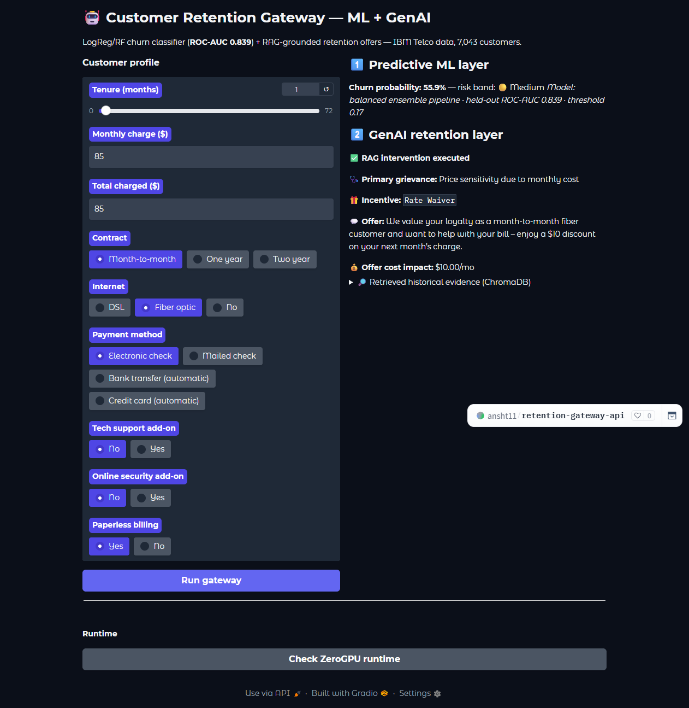

# Subscription Retention Prediction


*Executive Excel dashboard — KPI cards + four native charts (contract, tenure, internet service, revenue-at-risk).*

> 🎉 **Live demo is up:** [**AI Retention Gateway on Hugging Face Spaces**](https://huggingface.co/spaces/ansht11/retention-gateway-api)
> — real RF classifier (**ROC-AUC 0.839**) + ChromaDB RAG + Groq LLM generating retention offers, running free-tier.
> Direct app: https://ansht11-retention-gateway-api.hf.space


*Live deployed app: RF classifier scores a 1-month month-to-month fiber customer at 55.9% (Medium), the RAG layer retrieves similar historical profiles from the 7,043-customer index, and Groq's LLM returns a "Rate Waiver" offer with a $10/mo cost estimate.*

**Business problem:** A subscription business (real-world telco data, 7,043 customers) is
losing ~26% of customers. Which customers leave, why, and what does the revenue at risk
look like?

> Data note: real-world dataset (IBM Telco customer-churn sample). Every figure below is
> reproducible from the committed notebooks, SQL scripts, and dataset.

---

## Repository Structure

```
02_subscription-retention-prediction/
├── Churn_EDA_Analysis.ipynb        # cleaning, KPI baseline, segment analysis, statistics
├── Churn_Prediction_Analysis.ipynb # classification: LogReg + Random Forest (engineered features)
├── sql_queries/                    # 01_data_cleaning.sql + 02_churn_analysis.sql
├── src/build_churn_dashboard.py    # regenerates the Excel dashboard
├── excel_analysis/Churn_Dashboard.xlsx  # native Excel charts + filterable customer table
├── data/Telco_Customer_Churn.csv   # raw dataset (7,043 customers, 21 columns)
├── image/                          # all charts generated by the notebooks
├── outputs/                        # exported analysis tables and model metrics
└── README.md
```

---

## SQL Analysis (`sql_queries/`)

Seven business questions answered in MySQL, each with an inline business-question / metric /
answer / action comment block (same style as the Uber and supply-chain repos).

| # | Question | Key query feature | Answer |
|---|---|---|---|
| 1 | Overall health? | aggregates | 7,032 customers, 26.6% churn |
| 2 | Which contract churns most? | GROUP BY | Month-to-month 42.7% |
| 3 | When do customers leave? | CASE + LAG() | first 12 months |
| 4 | Which services/payments? | GROUP BY | fiber 41.9%, e-check 45.3% |
| 5 | Fiber confounder? | GROUP BY contract within service | both service and mix |
| 6 | Where is revenue at risk? | RANK() OVER | month-to-month + fiber = 72% |
| 7 | Do churned customers pay more? | STDDEV_SAMP() | yes, higher bills |

---

## Excel Dashboard (`excel_analysis/Churn_Dashboard.xlsx`)

**Interactive native Excel workbook** (regenerate with `python src/build_churn_dashboard.py`):
- **Dashboard** sheet - executive KPI cards and four native Excel charts covering contract, tenure, internet service, and revenue-at-risk segments
- **Customer_Detail** sheet - an autofiltered Excel table with customer-level filters for contract, internet service, payment method, tenure, charges, and churn
- **ChartData** sheet - visible, chart-ready pivot tables for auditability

Open in Excel and click any chart or use the filter dropdowns to explore the data interactively (preview shown at the top of this README; re-render via `src/render_dashboard_screenshot.py`).

---

## 🤖 GenAI Retention Layer (`/predict/v2`)

The ML layer answers *who will churn and with what probability*; the GenAI layer
answers *what to do about it* — grounded in real dataset evidence, never invented
(the live screenshot at the top of this README shows the full two-stage output).

### Two-stage gateway

```
customer features ──► Stage 1: classifier (ROC-AUC 0.839, threshold 0.17)
                          │
                          ├─ risk band Low (< 0.40) ──► plain prediction
                          │
                          └─ risk band Medium/High (≥ 0.40) ──► Stage 2 (RAG):
                                ├─ retrieve 3 most-similar historical customers
                                │   (ChromaDB + all-MiniLM-L6-v2 embeddings)
                                └─ LLM (Groq · gpt-oss-120b, free key)
                                    └─ strict-JSON retention offer
                                        (Pydantic-validated: grievance,
                                        incentive, pitch, cost impact)
```

**Design choices (and why):**
- **Grounded retrieval, not "chat with data":** every customer row in the Telco
  dataset is embedded as a natural-language profile; the incoming customer's
  profile is the query, so retrieved context = genuinely similar historical cases
- **Cost control:** the LLM fires only for Medium/High-risk customers (risk-band
  gate, tunable via `AI_TRIGGER_BAND` env var) — plain inference for everything else
- **Hallucination containment:** `temperature=0.1`, a `JsonOutputParser` +
  Pydantic schema (`RetentionStrategy`) enforce a fixed 4-field offer contract,
  and the prompt forbids inventing facts outside the retrieved evidence
- **Graceful degradation:** no API key / no index → the API still returns the
  correct ML prediction with a `genai_note` instead of failing

### Run the full stack (API + dashboard)

```bash
docker compose up --build
# API   → http://localhost:8000/docs   (POST /predict/v2)
# UI    → http://localhost:8501       (enter customer → ML score + AI offer)
```

### Run locally without Docker

```bash
pip install -r requirements-api.txt
python -m app.build_vector_index          # one-off ChromaDB build (~7k docs)
cp .env.example .env && set GROQ_API_KEY  # free key: https://console.groq.com
uvicorn app.main:app --port 8000          # terminal 1
pip install -r requirements-ui.txt
streamlit run app/frontend.py             # terminal 2 → http://localhost:8501
```

### Example `/predict/v2` response (high-risk customer)

```json
{
  "churn_probability": 0.8142,
  "risk_band": "High",
  "retrieved_evidence": [
    "5-month customer: Month-to-month contract, Fiber optic internet, TechSupport=No, ... outcome: customer left.",
    "..."
  ],
  "ai_retention_intervention": {
    "primary_grievance": "Price-to-value gap: new month-to-month fibre customer paying premium with no support add-ons bundled, matching the profile of historical churners who cited bill shock.",
    "incentive_category": "Rate Waiver",
    "personalized_offer_text": "We want to keep you on our fastest network — 10% off for 12 months plus complementary TechSupport add-on while we audit your bill setup.",
    "dollar_cost_impact": 8.75
  }
}
```

### Infrastructure

- **Dockerfile:** hardened multi-stage build (native wheel compile stage →
  slim non-root runtime, UID 8888, curl-based HEALTHCHECK)
- **docker-compose:** `retention-api` + `retention-dashboard` (Streamlit) with
  service-health gating and persistent `chroma_data` / `hf_cache` volumes

---

## 🧪 LLM & RAG Reliability Eval (eval_llm.py)

The GenAI layer is tested independently of a running API key — golden test cases cover schema validation, hallucination containment (Pydantic rejects invalid `incentive_category` values), customer description formatting, and graceful degradation when the vector index or API key is absent.

```bash
python eval_llm.py
# Expected: 5/5 tests passed
```

This separates "I integrated RAG" from "I verified my RAG pipeline is reliable."

---

## Statistical Validation (in `Churn_EDA_Analysis.ipynb`)

Every segment finding is tested formally (alpha = 0.05) with effect sizes, so the gaps are
structural, not sampling noise:

| Driver | Test | Statistic | p-value | Effect size |
|---|---|---|---|---|
| Contract type | Chi-square | chi2 = 1179.5 | < 0.001 | Cramér's V 0.41 (medium-large) |
| Internet service | Chi-square | chi2 = 728.7 | < 0.001 | Cramér's V 0.32 |
| Payment method | Chi-square | chi2 = 645.4 | < 0.001 | Cramér's V 0.30 |
| Online security | Chi-square | chi2 = 846.7 | < 0.001 | Cramér's V 0.35 |
| Tenure (churned vs kept) | Welch's t | t = -34.97 | < 0.001 | Cohen's d -0.86 (large) |
| Monthly charges | Welch's t | t = 18.34 | < 0.001 | Cohen's d 0.44 |
| Total charges | Welch's t | t = -18.80 | < 0.001 | Cohen's d -0.46 |

---

## KPI Baseline

| Metric | Value |
|---|---|
| Customers | 7,032 (after cleaning) |
| Churned customers | 1,869 |
| Churn rate | 26.6% |
| Monthly revenue | $456.1K |
| Monthly revenue at risk (churned) | $139.1K |
| Avg tenure | 32.4 months |

### KPI Handbook — what each headline number means

| KPI | Value | Definition |
|---|---|---|
| Total Customers | **7,032** | Rows after dropping missing `TotalCharges` (7,043 raw) |
| Churn Rate | **26.6%** | 1,869 churned / 7,032 customers |
| Avg Tenure | **32.4 months** | Mean months with the provider |
| Revenue at Risk | **$139.1K** | Sum of `MonthlyCharges` over churned customers |
| Model Accuracy | **80.0%** | Held-out accuracy (LogReg + Random Forest) |
| Model ROC-AUC | **0.839** | Held-out ranking quality — the model reliably scores would-be churners above stayers |

### Chart-by-chart walkthrough

**Confusion Matrix + ROC Curve** — the model evaluation pair: the confusion matrix shows where errors concentrate (false positives = wasted retention offers, false negatives = lost customers), and the ROC curve (AUC 0.839) shows strong separation well above the 0.5 diagonal. Threshold choice is a business call: lower it to catch more churners when retention offers are cheap, raise it when offers are expensive.


**Churn Drivers (feature importance)** — the explainability view: contract type, tenure band and internet service dominate the model, matching the EDA findings (42.7% month-to-month churn, 53.3% 0–6m churn). The model rediscovers the business logic independently, which is why stakeholders trust its ranked customer list.


**Churn by Contract / Tenure / Service** — the EDA foundation the model stands on: 42.7% vs 11.3% vs 2.8% by contract, 53.3% → 9.5% across tenure bands, fiber as the highest-risk service. Full per-chart explanations live in the analytics layer.


**Revenue-at-Risk Segments** — M2M + Fiber ≈ $100K of the $139K total exposure (~72%). The model's output is this ranked segment/customer list (`outputs/churn_segment_revenue.csv`), not an accuracy trophy.

---

## Business Questions Answered

| # | Question | Finding | Action |
|---|---|---|---|
| Q1 | Which contract type churns most? | Month-to-month churns an order of magnitude more than two-year plans | Push annual conversion early in the customer lifecycle |
| Q2 | When do customers leave? | Churn falls steadily with tenure; the first 12 months are the danger window | Onboarding + early check-ins for new customers |
| Q3 | Which services/payments churn hardest? | Fiber-optic and electronic-check payers churn far more | Service-quality outreach + auto-pay incentives |
| Q4 | Is fiber-optic churn the service or the contract mix? | Confounder check splits the two effects (see notebook) | Target the right lever per segment |
| Q5 | Where is revenue at risk concentrated? | Segment table ranks contract x service by monthly revenue at risk | Prioritise retention spend by saved revenue |

---

## Predictive Modelling (Part 2 - `Churn_Prediction_Analysis.ipynb`)

EDA explains which segments churned; the classification model scores **each individual
customer** so retention can act on people, not just segments.

- **Models:** Logistic Regression (interpretable), Random Forest, and XGBoost (gradient-boosted ensemble)
- **Feature engineering:** engineered leakage-safe features from account state - `charge_ratio`
  (average monthly charge paid, TotalCharges/(tenure+1)), `tenure_x_monthly` (lifetime value
  interaction), `monthly_above_avg` (premium flag). TotalCharges itself excluded (a tenure proxy).
**Held-out results (engineered features):**

| Model | Accuracy | ROC-AUC |
|---|---|---|
| Majority baseline | 73.4% | 0.500 |
| Logistic Regression | **80.0%** | **0.839** |
| Random Forest | 79.7% | 0.837 |
| XGBoost | — | — |

*XGBoost results added by running python src/train.py — identical feature set.*

Evaluated with accuracy, precision, recall, F1, ROC-AUC, confusion matrix and ROC curves; engineered features raised AUC from 0.833 to 0.839 through domain understanding, not parameter tuning.
- **Model drivers match the EDA and the statistics:** month-to-month contract, low tenure,
  fiber-optic service, electronic-check payment - segment insight confirmed three independent
  ways (descriptive gaps, significant chi-square/t-tests, and model feature importances).

Confusion matrix and ROC curves in `image/churn_cm_roc.png`; driver importances in
`image/churn_drivers.png`; full metric table in `outputs/churn_model_metrics.csv`.

**Threshold Analysis** — the cost-optimal threshold (0.17) is derived from an asymmetric cost function where a missed churner costs 5× a wasted retention offer. The full precision-recall-F1 vs threshold curve is in `image/threshold_analysis.png` (generated by `python src/train.py`). Lowering the threshold catches more churners at the cost of more false alarms — the right choice depends on the margin of each retention offer.

---

## ML Pipeline, Serving & MLOps (`src/`, `app/`, `Dockerfile`)

Reproducible training + scoring layer over the same notebook logic:

```
02_subscription-retention-prediction/
├── src/
│   ├── config.py              # paths, leakage-safe feature policy
│   ├── data_processing.py     # load + clean (7043 -> 7032 rows)
│   ├── feature_engineering.py # charge_ratio, tenure_x_monthly, monthly_above_avg
│   ├── modeling.py            # splits, LogReg/RF, CV, threshold, revenue-at-risk
│   └── train.py               # MLflow tracking + saves models/churn_model.pkl
├── app/main.py                # FastAPI: GET /health, POST /predict
├── tests/                     # pytest: preprocessing + modeling + API smoke
└── Dockerfile                 # python:3.10-slim, uvicorn on :8000
```

```bash
# 1. train (saves models/churn_model.pkl + outputs/churn_model_metrics.csv,
#    logs to mlruns/ if mlflow is installed, skips tracking if not)
pip install -r requirements.txt
python src/train.py

# 2. serve
uvicorn app.main:app --reload
curl -X POST localhost:8000/predict -H "Content-Type: application/json" \
  -d '{"tenure": 5, "MonthlyCharges": 92.0, "Contract": "Month-to-month"}'
# -> {"churn_probability": ..., "predicted_churn": ..., "risk_band": "High|Medium|Low"}

# 3. test + docker
pytest tests/ -q
docker build -t churn-api . && docker run -p 8000:8000 churn-api
```

---

## How to Reproduce

```bash
pip install -r requirements.txt
jupyter notebook Churn_EDA_Analysis.ipynb   # EDA + statistics
jupyter notebook Churn_Prediction_Analysis.ipynb  # modeling narrative
python src/train.py                          # reproducible pipeline + model artifact
```

All charts are saved to `image/` and analysis tables to `outputs/` by the notebook itself.

---

## 🛠️ Tech Stack & Deployment

| Layer | Technology |
|---|---|
| **Analysis / ML** | Python, Jupyter, pandas, SQL (MySQL), scikit-learn (LogReg + Random Forest), XGBoost, imbalanced-learn (class balancing), engineered features (`charge_ratio`, `tenure_x_monthly`) |
| **GenAI layer** | LangChain, **ChromaDB** vector index (7,043 embedded customer profiles), `all-MiniLM-L6-v2` sentence-transformers, Groq `gpt-oss-120b` (free tier), Pydantic strict-JSON output contract |
| **API** | FastAPI + Uvicorn (`POST /predict`, `POST /predict/v2`), Pydantic request/response models |
| **UI** | Streamlit dashboard; Gradio Blocks on the hosted demo |
| **Containers** | Docker multi-stage build (MLflow + XGBoost artifacts included), docker-compose (API + UI stack) |
| **Testing** | pytest suite (scoring, feature contract, graceful degradation without API key) |
| **Cloud deployment** | **Hugging Face Spaces** (Gradio SDK, ZeroGPU free tier) — [live demo](https://huggingface.co/spaces/ansht11/retention-gateway-api) |
| **DevOps** | Git/GitLab, CI-style reproducible pipeline (`src/train.py`), secrets via managed Space settings (never in code), Git LFS for model/vector-index artifacts |

**Cloud deployment flow:** repo pushed with `git` (prebuilt ChromaDB index via Git LFS) → HF builds the container → Gradio gateway served at a public HTTPS endpoint (`https://ansht11-retention-gateway-api.hf.space`) → `GROQ_API_KEY` injected at runtime as a managed secret → cost-gated two-stage inference (ML always on, LLM only for Medium/High risk).