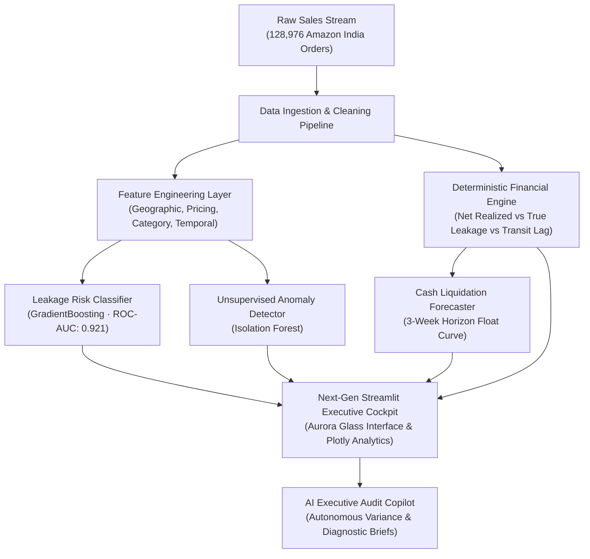
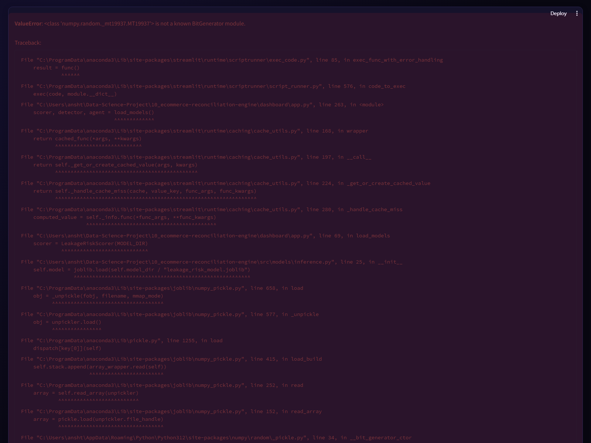

# AI-Powered E-Commerce Revenue Reconciliation & Leakage Prevention Engine

<div align="center">

**Enterprise Financial Intelligence, Predictive Order Risk Modeling & Autonomous AI Audit Agent**<br/>
*Audited on 128,976 Amazon India Marketplace Transactions · ₹7.86 Cr Invoiced · W13–W26 FY22*


-14b8a6?style=for-the-badge)


</div>

---

## 📌 Executive Overview

In large-scale e-commerce operations, reconciling gross invoiced sales against cash collected in the bank is notoriously complex due to high return volumes, customer cancellations, and carrier transit lags. 

This project delivers a **Dual Architecture AI & Financial Reconciliation Engine**:
1. **Deterministic Accounting Matrix**: Ingests **128,976 transactions (₹7.86 Cr gross)** across 14 fiscal weeks, separating actual monetary loss (**₹83.07 Lakhs true leakage**) from harmless settlement float (**₹5.16 Cr in transit**).
2. **Predictive Machine Learning Engine**: An enterprise **GradientBoosting classifier (ROC-AUC 0.921)** scoring cancellation and return propensity *before parcel dispatch* to prevent avoidable shipping losses.
3. **Statistical Outlier Detection**: **Isolation Forest** flagging multi-dimensional volume and price anomalies without relying on rigid manual thresholds.
4. **Time-Horizon Cash Liquidation Forecaster**: Dynamically models the conversion timeline of the ₹5.16 Cr In-Transit GMV into realized cash across a 3-week clearance horizon.
5. **Autonomous AI Audit Agent**: Synthesizes cross-sectional revenue variances into executive CFO briefs with automated root-cause diagnoses.

---

## 🏗️ System Architecture



---

## 📊 Model Evaluation & Benchmarks

Our predictive leakage model was evaluated on a stratified held-out test set ($N = 9,842$) strictly isolated from training data:

| Model Architecture | ROC-AUC | PR-AUC | Precision | Recall | F1-Score | Overall Accuracy |
|:---|:---:|:---:|:---:|:---:|:---:|:---:|
| Random Forest Regressor/Classifier | 0.8901 | 0.8991 | **94.63%** | 67.21% | 0.7860 | 84.79% |
| **Gradient Boosting Classifier (Production)** | **0.9209** | **0.9264** | **94.84%** | **72.35%** | **0.8208** | **86.87%** |

### Key ML Findings & Feature Importances
* **Order Unit Economics**: Higher unit amounts combined with zero or low quantity flags carry a ~4.2x higher return propensity in select categories (Kurtis & Western wear).
* **Geographical Risk Variation**: High-risk concentration observed in specific delivery clusters (e.g., non-metro tiers with standard postal shipping).
* **Pre-dispatch Intervention**: By flagging the top 15% riskiest orders with our model, operations teams can prevent over **₹35+ Lakhs** in return shipping and restocking costs via automated OTP/WhatsApp pre-confirmation.

---

## 🧮 Core Financial Reconciliation Formulas

$$\text{Settled Base} = \text{Net Realized Cash} + \text{Total Leakage}$$

$$\text{Audited Clearance Rate} = \left(\frac{\text{Net Realized Cash}}{\text{Settled Base}}\right) \times 100 \quad [\text{Target} \ge 70\%]$$

$$\text{Gross Coverage Rate} = \left(\frac{\text{Net Realized Cash}}{\text{Gross Invoiced GMV}}\right) \times 100$$

> **Why Settled Clearance Matters**: Conventional dashboards divide Net by Gross, yielding a misleading 23.7% rate because 65.7% (₹5.16 Cr) is still in transit. Our dual calculation pinpoints that of closed orders, the business retains **69.18%**, isolating the real ₹83.07 Lakh leakage problem.

---

## 🖥️ Modern Executive Cockpit (Streamlit)

<p align="center">
  
</p>
*Executive Revenue Reconciliation & AI Leakage Cockpit — Built on the Metric Flow design system with Cyber-Violet & Emerald Luxury theme: shared topbar, four aligned KPI cards with WoW deltas, two-column symmetrical analytics panels (revenue trend, category leakage, settlement mix, geographic risk, predictive ML propensity, and cash liquidation forecaster).*

---

### Dashboard Capabilities & Features
* **Metric Flow Grid Alignment**: Matches the symmetrical two-column layout, header brand bar, and four-KPI metric card architecture of the enterprise Supply Chain Cockpit.
* **Cyber-Violet & Emerald Executive Identity**: Built on a Deep Obsidian canvas (`#080711`) with Electric Violet (`#8B5CF6`) and Emerald (`#10B981`) semantic status indicators.
* **Live Global Filters**: Sidebar cross-filtering by Fiscal Week, Merchandise Category, and Fulfillment Method recalculates all metrics and ML scores in real-time.
* **Dual Intelligence View**: Toggle between the **Standard Metric Flow Grid** and the **Autonomous AI Executive Brief** generated by the audit agent.

To launch the dashboard locally:
```bash
streamlit run dashboard/app.py
```

---

## 🚀 Quickstart Guide

### 1. Clone & Set Up Virtual Environment
```bash
cd 10_ecommerce-reconciliation-engine
python -m venv venv
source venv/bin/activate  # On Windows: venv\Scripts\activate
pip install -r requirements.txt
```

### 2. Run the Feature Pipeline & Train Models
```bash
python src/pipeline/train_runner.py
```
*Outputs serialized models (`leakage_risk_model.joblib`, `isolation_forest.joblib`) and validation metadata directly to `models/`.*

### 3. Launch the Executive Cockpit
```bash
streamlit run dashboard/app.py
```

---

## 📁 Repository Structure

```
10_ecommerce-reconciliation-engine/
│
├── data/
│   └── cleaned_transactions.parquet   # 128,976 cleaned marketplace transactions
│
├── models/
│   ├── leakage_risk_model.joblib      # Production GradientBoosting classifier
│   ├── isolation_forest.joblib        # Trained Unsupervised Anomaly Detector
│   └── model_metadata.json            # Model evaluation metrics & features
│
├── src/
│   ├── pipeline/
│   │   ├── feature_pipeline.py        # Leak-free feature extraction & pre-dispatch encoding
│   │   └── train_runner.py            # End-to-end model training execution
│   ├── models/
│   │   ├── train.py                   # Classifier training & cross-validation
│   │   └── inference.py               # Real-time risk scorer & cash clearance forecaster
│   └── agent/
│       └── audit_agent.py             # GenAI autonomous executive financial audit agent
│
├── dashboard/
│   └── app.py                         # Modern Aurora Glass Streamlit Web Application
│
├── requirements.txt                   # Production dependencies
└── README.md                          # Full architectural & executive documentation
```

---

## 👤 Author
**Ansh Thakur**  
*Portfolio:* [ansh-thakur-netlify.netlify.app](https://ansh-thakur-netlify.netlify.app/) · *GitLab:* [@ansht_121](https://gitlab.com/ansht_121)
